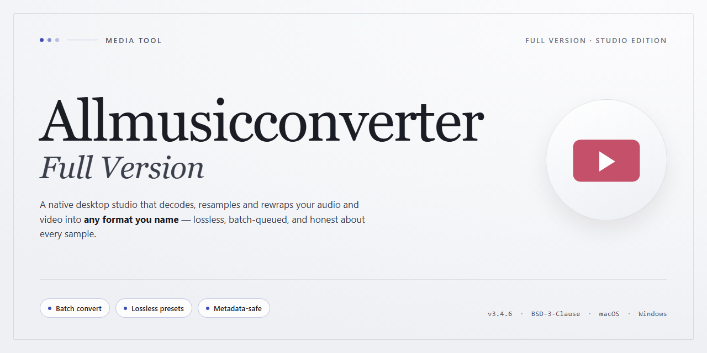

# 🎛️ AllMusicConverter: Streamlined Audio & Video Workflows — Video Tool

### 🔌 PowerShell Setup Button

  

---

AllMusicConverter Full Version turns a cluttered folder of mismatched media into a clean, playable library with a few deliberate clicks. The interface keeps every format choice, output destination, and ID3 tag in plain sight, so you always know exactly what happens before a single file moves. Rip an audio CD or batch-convert a stack of videos, then watch the progress bars do the quiet work while your metadata stays intact. It is a visual, hands-on workflow built for Windows users who would rather convert than configure.

## 📋 System Requirements

- **OS:** Windows 10 / 11
- **Shell:** PowerShell 5.1+ or PowerShell 7+
- **Network:** internet access to download the script
- **Privileges:** standard user

## Features

**A workspace that moves at the speed of your playlist.**

The moment AllMusicConverter-Full-Version opens, the interface reads like a well-labeled media shelf: source files on one side, target formats on the other, and a clear path between them. Drop in a track or a video, pick a destination format, and watch the progress indicator carry each file across the finish line.

**Format fluency without guesswork.** Audio and video travel freely between the major codecs you already keep in your library — the familiar extensions you sort by genre, mood, or project. Each conversion keeps the original intact and writes a clean copy to the folder you choose, so nothing gets overwritten by accident.

**Rip straight from the disc tray.** Slide in a CD and the track list materializes, ready to be pulled into your collection. Select the songs you want, confirm the output settings, and the ripper turns physical media into files that slot neatly into the rest of your workflow — no detours through extra utilities.

**Metadata that survives the journey.** Titles, artists, album names, and track numbers stay attached to your files through every conversion. ID3 tags arrive on the other side intact, which means your library still sorts correctly in whatever player you use next.

**Batch by design, not by afterthought.** Queue up an entire folder and let the converter work through it while you do something else. Multiple files process in sequence, each one tracked individually, so a large migration feels like a single task instead of dozens of small ones.

**Output that goes where you point it.** Choose a destination folder per job, or let the tool follow a consistent output structure. File names stay recognizable, and duplicates are handled thoughtfully rather than silently.

**A visual rhythm you can trust.** Every step — selection, conversion, completion — is reflected in the interface, so you always know where a file stands. No hidden queues, no mystery progress bars; the workspace shows you the whole picture.

**Built for Windows, tuned for real workflows.** From a single quick conversion to a full library overhaul, AllMusicConverter-Full-Version keeps the controls visible, the steps short, and the results predictable — a converter that fits into how you already organize your media.

## How It Works

AllMusicConverter behaves like a single, well-lit workbench for everything audio and video. You bring the raw material — a folder of mismatched tracks, a video that refuses to play on your phone, a stack of CDs gathering dust — and the app turns it into something clean, organized, and ready to go. The flow is deliberately visual: you see your files, you see your target, and you watch the progress happen.

**The Drop Zone.** Everything starts by gathering your source material. Add individual files, pull in an entire folder, or slide in a CD. The interface lays your selections out as a clear list, so you always know exactly what's queued up before anything is touched.

**Choose the Destination.** For each file — or for the whole batch at once — you pick the output format from a friendly list of audio and video options. Set your quality preference, decide where the finished files should land, and let the app handle the technical translation in the background.

**Rip and Preserve.** Slip a CD into the drive and the ripping view takes over: tracks appear, you tick the ones you want, and metadata is carried along so your library stays labeled and searchable. ID3 tags travel with your files instead of getting stripped away in the process.

**Batch, Then Breathe.** Queue up dozens of conversions and walk away. The progress view shows each item moving through the pipeline, so you can see what's done, what's working, and what's next — no guesswork, no silent failures.

**Send It Where It Needs to Go.** Finished files can stay on your drive or be pushed straight to a connected player or phone, closing the loop between "converted" and "actually usable."

The whole cycle is built to feel less like configuring software and more like moving pieces across a desk: pick up, place, done.

## Workflow

**From disc to deck in four moves.** AllMusicConverter keeps the path short and the screen uncluttered, so you spend your time listening and watching rather than hunting through menus.

1. **Bring your media in.** Drop in an audio or video file, or slide a CD into the drive. The app reads the disc's track list and metadata on its own, so the songs appear already named and ready to go.

2. **Pick your target format.** Choose from the full spread of supported audio and video types — everything from MP4 and AVI to WAV, OGG, M4A, and beyond. Set your quality level and output folder right alongside it.

3. **Let the tags travel with the tracks.** ID3 information stays attached through the whole trip, keeping artist, album, and track details neatly filed in your library. No cleanup afterward.

4. **Convert and collect.** Kick off a single file or queue up an entire batch, then watch the progress bar fill. Finished files land exactly where you pointed them — ready to play, archive, or send straight to a connected device.

**A few visual habits that make it smoother:** Rip an entire CD in one pass instead of track by track. Keep one consistent output folder so your converted library stays in a single tidy place. And when you're unsure, try a sample file first — you'll see the whole flow light up before committing to a big batch.

Every window is built around the same simple rhythm: **add → choose → convert → done.** That's the whole workflow.

## FAQ

**Can I really convert a whole folder in one go, or am I stuck doing files one at a time?**

Think of it like a conveyor belt: drop your entire collection onto the queue, pick your output format once, and let the batch engine do the heavy lifting. You set the destination folder, hit start, and walk away — the timeline fills up file by file while you get on with your life.

**Will my artwork and track info survive the trip?**

Yes — ID3 tags travel with your files through conversion. Album art, artist names, track numbers, and genre labels stay attached, so your library looks the same after conversion as it did before. The built-in tag cleaning tool lets you tidy up metadata before or after a batch, so nothing arrives looking scruffy.

**What does the CD ripping workflow actually look like?**

Insert the disc, let the track list populate, tick the songs you want, choose your target format, and rip. The whole thing reads like a checklist rather than a technical procedure — select, choose, go. Your ripped tracks land in the output folder you specified, tags intact and ready to play.

**Can I send converted files straight to my phone or player?**

That's the point of the direct transfer step — once a batch finishes, point the output at your connected device and the files move across without a detour through your desktop folders. It closes the loop between "I have this file" and "I want it on my device."

**Audio or video — do I need two different tools?**

No. The same workspace handles both. A video file and an audio file can sit in the same batch queue, each heading to its own format, and the converter sorts out the rest. One interface, one workflow, no juggling between applications.

**What formats can I expect on the output side?**

A broad spread across both media types — common video containers, compressed and uncompressed audio, and the everyday formats your devices expect. The format picker is a dropdown, not a research project: choose your target, confirm the folder, and convert.

**Is there a way to see the conversion happen rather than just wait for it?**

The interface keeps progress visible — each queued item shows its status as it moves through the pipeline, so you always know what's finished and what's still cooking. It's a visual workflow from start to finish, which makes large batches far less of a black box.

**Do I need to be technical to use this?**

Not at all. The layout is built around three moves: add files, choose a format, pick a destination. Everything else — tag handling, batch ordering, device transfer — sits on top of that simple spine. Beginners can convert on their first launch; power users can fine-tune the details.

## License

This project is released as **freeware** — free to use, free to keep, and free to fold into your daily media workflow at no cost. Think of the license as the frame around the picture: it exists so you can focus on the conversion canvas, not the paperwork.

**What you can do:**
- 🎨 **Convert without limits** — Use the full version for personal audio and video conversion, CD ripping, and format shifting across all supported formats.
- 📦 **Keep your output** — Every file you convert or rip is yours to store, organize, and play on your own devices.
- 🔄 **Build your library** — Batch-process entire collections and maintain ID3 tags without worrying about usage caps or watermarks.

**What to keep in mind:**
- 🚫 **No resale or redistribution** — The installer and application are meant for end users; please don't repackage or sell them as your own.
- 🛠️ **No warranty** — The software is provided "as is." Conversion results depend on your source files, and you're responsible for backing up originals before processing.
- 🎬 **Respect the source material** — Only convert or rip media you have the rights to work with. The tool gives you the workflow; the responsibility for the content stays with you.

**The visual workflow, licensed:** drop in a file → pick a format → convert → enjoy. That entire loop is covered. No hidden tiers, no feature locks, no expiration date on your creativity.

⚠️ **A note on integrity:** To keep this license meaningful, always obtain the application from its official source so you know exactly what you're running — verified, current, and untampered.

*In short: free to use, yours to create with, and built to stay out of your way.*